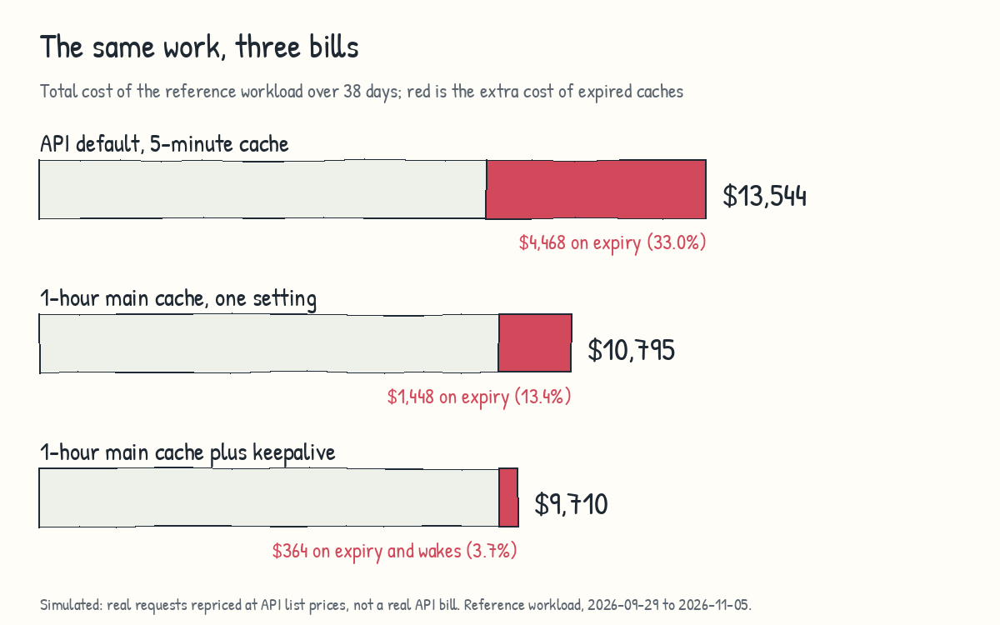

<div align="center">


**Your coding agent's memory goes cold while it waits. ember keeps it warm, powered by [versa](https://versa.training)**

<a href="CHANGELOG.md"></a>
<a href="#find-out-what-it-costs-you"></a>
<a href="LICENSE"></a>

<table>
<tr>
<td align="center" width="33.3%"><h3>33%</h3>of Claude cost goes to expired caches on default API settings<br><sub>simulated on <a href="#the-problem">a heavy multi-agent workload</a></sub></td>
<td align="center" width="33.3%"><h3>13.4%</h3>on the same workload with one setting: main agent on 1hr cache TTL<br></td>
<td align="center" width="33.3%"><h3>3.7%</h3>when keeping the cache fresh with <br>ember</br></td>
</tr>
</table>

**[Your number](#find-out-what-it-costs-you) · [The problem](#the-problem) · [What ember does](#what-ember-does) · [Which setup](#which-setup-should-you-use) · [Commands](#commands) · [For coding agents](#for-coding-agents) · [Disclaimer](#disclaimer)**

</div>

> **ember is experimental:** it depends on cache behavior and prices that Anthropic controls and can change without notice, so run the estimate first. Used wrongly, it can cost you more: see the [Disclaimer](#disclaimer).

## Find out what it costs you

Don't believe my numbers. Ask your agent to estimate your potential cost savings based on your session history.

Run this and see your own number. You need Node 22 or newer on PATH.

```text
git clone https://github.com/versa-training/ember.git
node ember/scripts/estimate-savings.js --days 30
```
The estimate reads only your local transcripts, starts no agents, and makes no model call.

Ask your agent to interpret the results.

## Installation

```text
/plugin marketplace add versa-training/ember
/plugin install ember@ember
```

Installing adds hooks to keep your agents fresh. 

**Or tell your agent:**

```text
Install the ember plugin from github.com/versa-training/ember and run /ember:benchmark, then tell me which mode to use.
```

The output looks like this. These are the main agent figures published for the reference workload, trimmed to one block. Every row except actual is simulated, and the wake rows come from a newer run than the others. That workload already ran its main agents on 1 hour, so that row equals actual. A negative saving means the mode costs more.

```text
ember savings estimate, all transcripts, from ~/.claude/projects.
SIMULATED. Nothing was measured and no agent was run. API list prices dated 2026-11-05. Same requests and pauses in every row.

Main agents:
  Simulated cost per mode, saving against actual:
    Actual (measured requests, list prices)        $4,377.05
    5 minutes, no refresh                          $7,127.03     -$2,749.98     -62.8%
    5 minutes, wake every 4:30, up to 4            $4,529.00       -$151.95      -3.5%
    5 minutes, wake every 4:30, up to 24           $4,926.00       -$548.95     -12.5%
    1 hour, no refresh                             $4,377.05         +$0.00       0.0%
    1 hour, wake every 59 min, up to 4             $4,177.00       +$200.05       4.6%
```

## The problem

Claude caches your agent's context. On Opus 5.5 and Sonnet 5.5, a warm read costs 0.05x the input price. Every pause longer than the cache lifetime makes your agent pay to rewrite its whole context: 1.25x on a 5-minute cache, 2x on a 1-hour cache. Your agent pauses whenever it waits for you or for a tool.



These numbers come from a real heavy multi-agent workload, the reference workload: 157,267 requests over 38 days, repriced at API list prices. They are simulated, not a real bill. Your numbers will differ.

<details>
<summary>The numbers behind the chart</summary>

| Scenario | Main | Subagents | Total |
| --- | --- | --- | --- |
| Everything on 5 minutes | $7,127.03 (simulated) | $6,417.45 (measured) | $13,544.48 |
| Main 1 hour, subagents 5 minutes (actual use) | $4,377.05 (measured) | $6,417.45 (measured) | $10,794.50 |
| Everything on 1 hour | $4,377.05 (measured) | $6,558.98 (simulated) | $10,936.03 |

- Dates: 2026-09-29 to 2026-11-05. The same requests and pauses are assumed in every row.
- Expiries cost $4,468.12 on 5 minutes (33.0%, range 32.1% to 35.0% depending on the expiry assumption) and $1,448.41 on the actual setup (13.4%). Both are simulated.
- Simulated keepalive on the actual setup: cost $138.80, expiry avoided $1,223.56, net $1,084.76 ($1,009.19 if sessions are abandoned).
- Of that net, the main agent is $300.03 and subagent check-ins are $784.73. The subagent figure assumes check-ins that only a foreground Bash timeout above 270 seconds triggers. $120.76 of the $878.67 subagent expiry avoided has no such timeout, so the hook cannot act on it.
- The report prints the 5-minute expiry cost as the row "Extra cost of expiries" under "Everything on 5 minutes".

The arithmetic: [docs/pricing-math.md](docs/pricing-math.md).

</details>

## What ember does

Two small hooks.

| Hook | Who it helps | What it does |
| --- | --- | --- |
| Subagent hook | Subagents on a 5-minute cache | Long waits run in the background, and your subagent checks in under 4:30. On a 1-hour subagent cache the limit is 59 minutes |
| Wake hook | Your main agent, on a 5-minute or 1-hour cache | A wake just before the cache expires (4:30 or 59 minutes), at most 4 between your prompts |

**The biggest single win needs no plugin.** If you use an API key or a cloud provider, set `"promptCacheTtl": "1h"` in your settings. It needs Claude Code v2.1.242 or later. On the reference workload, it takes the total from $13,544.48 to $10,794.50 (simulated). The hooks add less: a net $1,084.76 (simulated).

## Which setup should you use

| Your usage | Main agent | Subagents | Why (simulated, reference workload) |
| --- | --- | --- | --- |
| Long interactive sessions, API key | 1 hour, wake hook optional | 5 minutes, subagent hook | Main agents with 4 or more pauses: $6,413.58 on 5 minutes vs. $3,593.25 on 1 hour |
| Short one-shot agents | 5 minutes | 5 minutes | Main agents with no pause: $335.68 on 5 minutes vs. $415.39 on 1 hour. 76.8% of main agents and 86.4% of subagents never hit a pause |
| Mostly subagents that wait often | 1 hour | `subagentPromptCacheTtl` at `1h`, with `EMBER_SUBAGENT=0` | Subagents with 4 or more pauses: $1,238.51 on 5 minutes vs. $703.36 on 1 hour. Past 67.5 minutes of total waiting, the 1-hour premium is cheaper than check-ins. Over all subagents the two are close: $6,417.45 (measured) vs. $6,558.98 |
| Subscription | Run the estimate, then decide | Run the estimate, then decide | Dollars are an equivalent, not a bill. Wakes use plan quota, and the savings are not proven there. `EMBER_MAIN=0` turns wakes off |

Most short agents should stay on 5 minutes, as Anthropic argues. A 1-hour write costs 2x against 1.25x, and it pays off only when your agent comes back. The rule the math supports: main agent on 1 hour with an optional wake at 59 minutes, subagents on 5 minutes with a check-in every 4:30 while waiting. See [docs/pricing-math.md](docs/pricing-math.md).

## Benchmark your own usage

`/ember:benchmark` prices each cache mode on your own history and shows how often your agents pause. Method, modes, and limits: [docs/benchmarks.md](docs/benchmarks.md).

## Commands

| Command | What it does |
| --- | --- |
| `/ember:benchmark` | Runs `scripts/check-env.js` and `scripts/estimate-savings.js` and interprets them. Reads history only, starts no agent |
| `/ember:report` | Prints the cost report |
| `/ember:wakes <count>` | Sets the wake limit for this session. You can also tell your agent, for example "12 wakes". `0` turns wakes off |
| `node scripts/estimate-savings.js --days N` | Estimates each cache mode on your history (simulated, free) |
| `node scripts/cache-report.js --days N --dir PATH --json` | Runs the report from a clone |
| `node scripts/check-env.js` | Prints the Claude Code version, the cache lifetime in recent transcripts, and relevant environment variables |

## Configuration

ember reads the cache lifetime from your Claude Code configuration on every hook call, separately for the main agent and for subagents. Nothing is stored. Leave the `EMBER_*` lifetime overrides unset: they exist for testing.

**Main agent lifetime**, first match:

1. `EMBER_MAIN_TTL` (`5m` or `1h`, for testing)
2. The newest cache write in the transcript, because it is what happened
3. `FORCE_PROMPT_CACHING_5M=1`
4. `CLAUDE_CODE_PROMPT_CACHE_TTL`, in the environment, then in the `env` block of a settings file
5. `promptCacheTtl` in a settings file
6. `ENABLE_PROMPT_CACHING_1H=1`
7. Unknown: the plan decides the default, so ember waits for the first cache write

**Subagent lifetime**, first match: `EMBER_SUBAGENT_TTL`, `FORCE_PROMPT_CACHING_5M=1`, `CLAUDE_CODE_SUBAGENT_PROMPT_CACHE_TTL`, `subagentPromptCacheTtl`, `ENABLE_PROMPT_CACHING_1H=1`, then `5m`. A `cacheTtl` in a subagent's frontmatter is not read.

Settings files, first match: `/etc/claude-code/managed-settings.json`, `<cwd>/.claude/settings.local.json`, `<cwd>/.claude/settings.json`, `~/.claude/settings.json`. Files are read again on every call. A missing or malformed file is skipped, and a value other than `5m` or `1h` is ignored.

**Intervals** follow the lifetime: 5 minutes gives 270 seconds, 1 hour gives 3540 seconds. A sleeping wake hook resolves the lifetime again about once a minute and just before it wakes. If you change a settings file while it sleeps, the deadline moves, counted from the hook's start. Limit: a hook keeps the environment it started with, so a variable changed during a session is not seen. Settings files are.

`node scripts/check-env.js` prints the lifetime, interval, and wake limit per agent type with the source of each value. When the transcript and the configuration disagree, it says so.

<details>
<summary>Environment variables</summary>

| Variable | Default | Effect |
| --- | --- | --- |
| `EMBER_MAIN=0` | on | Turns off the Stop hook wakes |
| `EMBER_SUBAGENT=0` | on | Turns off the subagent hook |
| `EMBER_MAIN_TTL`, `EMBER_SUBAGENT_TTL` | unset | Test overrides of the resolved lifetime (`5m` or `1h`). Leave them unset |
| `EMBER_SUBAGENT_WAIT_MS` | from the lifetime: 270000 or 3540000 | Longest foreground Bash timeout a subagent may use. Overrides exactly |
| `EMBER_MAIN_INTERVAL_SEC` | from the lifetime: 270 or 3540 | Seconds between wakes. Overrides exactly. Setting it skips the transcript wait, and a headless run may then wait for a pending sleeper before it exits |
| `EMBER_MAX_WAKES` | 4 | Wakes allowed before the limit resets. A limit set with `/ember:wakes` wins for that session |
| `EMBER_WAKE_MESSAGE` | `ember keepalive: ...` | Text of the wake turn |
| `EMBER_STATE_DIR` | `~/.claude/ember` | Where wake state is stored. It must be a real directory you own, not a symlink, or the hooks do nothing |
| `EMBER_LOG`, `EMBER_RESOLVE_MS`, `EMBER_TRANSCRIPT_ROOT` | unset | Testing aids: a file that records each sleeper deadline, the re-resolve period in milliseconds, and the folder `check-env.js` reads transcripts from |

</details>

## For coding agents

- Read [AGENTS.md](AGENTS.md) first.
- Use the scripts for all arithmetic and parsing. Never compute figures by hand.
- Never start agents or sessions to benchmark. The estimate reads history only.
- Label figures as simulated at API list prices, and give the dates. Say that your user's figures will differ from the reference workload.

## How it works

The subagent hook is a `PreToolUse` hook. It denies a foreground Bash timeout above the subagent's interval (270 seconds on a 5-minute cache) and tells the subagent to rerun in the background and keep polling. The wake hook is a `Stop` hook with `asyncRewake`. It sleeps one interval (270 seconds or 59 minutes), then wakes the session for a one-word turn, which is a real turn in your transcript.

<details>
<summary>Hook details and test status</summary>

**Subagent hook**

- It does nothing when `CLAUDE_CODE_DISABLE_BACKGROUND_TASKS` is set to a truthy value, because the instruction cannot be followed.
- On a 1-hour subagent lifetime the limit is 3540 seconds, so it effectively never denies.
- The deny text includes a polling command, because a call that starts with `sleep` is rejected by Claude Code and a subagent that ends its turn waits for the finish notification without a request.
- A foreground subagent that runs longer than the main agent's lifetime cannot be helped: the main agent is inside one turn, so no Stop hook fires and its cache expires.
- It denies the call and does not shorten it, because a test showed a shortened timeout killed the command with exit code 143.

**Wake hook**

- It wakes at most 4 times before the limit resets, on a 5-minute or 1-hour main lifetime. A subagent cannot be woken by a hook: a hook wake goes to the main session only (tested).
- The limit resets on every `UserPromptSubmit` event. The Claude Code docs say that event also fires on some turns Claude Code starts on its own, so the limit can reset on those too. This is untested.
- The sleep ends one interval after the hook starts, because the transcript at Stop can lack the current turn. A final response that streams for more than 60 seconds can therefore let the cache expire before the wake (about 0.13% of final turns on the reference workload).
- A newer Stop or prompt ends the sleep within about 5 seconds.
- A wake that would come more than 60 seconds late, for example after a laptop suspend, is skipped because the cache has probably expired already.

**Tested.** Unit tests pass (`npm test`). The live tests below ran under the earlier name warmcache on the same code, against Claude Code:

- `asyncRewake` woke a headless stream-json session on Claude Code 2.1.310 with a 12-second interval, and the wake limit held (2 wakes with a limit of 2, then none).
- Subagent hook, 2.1.310, haiku, cap set to 5 seconds: a subagent asked to run `sleep 12; echo finished` with a long Bash timeout was denied, then reran the same command with `run_in_background: true` and read the output `finished`. One run.
- A review confirmed that `claude plugin validate` passes, that `--plugin-dir` loads the plugin on 2.1.310, and that a wake fired and a limit of 1 held in a live headless run.
- In one-shot `-p` mode the transcript at Stop lacked the current turn, so no sleeper started.
- An interactive session with a short interval showed 4 wakes and the limit of 4 held. The UI displays each wake as "Stop hook feedback".
- Wake timing, 2.1.310, interactive, interval 60 seconds: before 0.1.3 the second wake came 1 second after the first, because the transcript at Stop lacked the current turn. After the fix the hooks started 60.9 and 60.8 seconds apart. One run each.

**Live tests of 0.3.0.** Claude Code 2.1.310, haiku, headless stream-json, 5-minute lifetime, the real 270-second interval, one run each. Tables: `results` in the ember-test repository.

- Main idle 17 minutes with a limit of 3: 3 wakes at 272, 271, and 271 seconds after the previous request, each a cache hit, then none. With `EMBER_MAIN=0`, no wake in 11 minutes.
- Subagent, ember on: the foreground call with a 600000 ms timeout was denied. With the first two versions of the deny text the subagent reran in the background and then ended its turn, so its next request came 471 and 475 seconds later with a full rewrite. With the current text it polled with gaps of 241 and 238 seconds, all cache hits, and the task finished. Three runs, so this depends on the model following the text.
- Subagent, `EMBER_SUBAGENT=0`: the foreground call ran 482 seconds and the next request rewrote the full context (cache read 0).
- Main waiting on a background subagent: the main wake fired at 272 seconds as a cache hit while the subagent ran, and the finish notification woke the main agent normally. The idle background subagent expired its own cache (gap 353 seconds, full rewrite).
- A foreground subagent longer than 5 minutes: the main agent's next request came 489 seconds later with a full rewrite, because no Stop hook fires during a turn.
- Configuration: with both lifetimes at `1h`, `check-env.js` and the first sleeper deadline gave 3540 seconds and a 590000 ms subagent timeout was allowed. Editing `promptCacheTtl` in a settings file from `5m` to `1h` while a sleeper ran moved its deadline from 270 to 3540 seconds and `check-env.js` followed.
- A hook cannot wake a subagent. A throwaway `asyncRewake` hook on `PreToolUse` and `SubagentStop` woke the main session only.

**Untested.** Laptop suspend, `/clear` with a pending sleeper, an interactive session at the 270-second interval (the launch was blocked by this machine's agent tooling), the real 59-minute interval, and a settings change made while a live Claude Code session ran.

</details>

## Disclaimer

**Anthropic controls what ember depends on.** Cache lifetimes, prices, and hook behavior can change at any time, without notice. Used wrongly, ember can cost you more, not less. Run the report before and after any Claude Code upgrade.

**This has happened before.** Users measured Claude Code cache writes moving from 1 hour to 5 minutes around early March 2026, with no announcement they could find ([issue 46829](https://github.com/anthropics/claude-code/issues/46829), closed as not planned).

**Anthropic's reply.** In that issue, [Jarred-Sumner, writing for the Claude Code team](https://github.com/anthropics/claude-code/issues/46829#issuecomment-4231266649), describes the change as deliberate optimization, not a regression. The points:

- 1-hour writes cost more (2x vs. 1.25x) and do not pay off for one-shot requests.
- The client selects a lifetime per request.
- The change lowers cost across the request mix.

The commenter [bcherny](https://github.com/anthropics/claude-code/issues/46829#issuecomment-4237689126), whose GitHub profile says "Claude Code @ Anthropic", wrote: "we use experiment gates that are cached client-side" and "We also are not defaulting API customers to 1h yet". bcherny also wrote that the savings are "nowhere near 12x" and "a small win".

**A later report.** [Issue 84253](https://github.com/anthropics/claude-code/issues/84253), still open, saw 5-minute-only writes from 2.1.218. Later comments in that thread say the remainder was a detection gap. A subscription token passed through `ANTHROPIC_AUTH_TOKEN` gets the API-key default. One commenter measured 1 hour on all 29 versions tested with a plain subscription login.

**What the data can and cannot show.** ember's report charges every write at the lifetime's price, so one-shot requests are counted. On the reference workload, 76.8% of main agents and 86.4% of subagents never hit a pause of 5 to 60 minutes, and 5 minutes is the right choice for them. That agrees with Anthropic's argument. Anthropic's claim covers all users, which one workload cannot test.

**Newer versions may already cover part of this.**

- Claude Code 2.1.318 changelog: "Changed background subagents to move a shell command to the background after 3 minutes on all providers, so the prompt cache doesn't expire while it runs".
- Claude Code 2.1.314 changelog: "Added idle compaction to VS Code and Claude Desktop's Code tab: a 200K+ token conversation left idle is summarized, and the summary is used on your next message if the prompt cache has expired".

**The figures are simulated.** They come from one workload at API list prices. They are not a real bill, and yours will differ. No result is guaranteed.

**Subscriptions.** Wakes use plan quota. How quota weights cached reads is unknown. The savings are not proven for subscriptions.

**No affiliation.** This project is not affiliated with Anthropic.

## Privacy

Everything stays local. The plugin code makes no network calls and collects no telemetry. Wakes and the report's chat output go to the model like any other turn. The hooks store wake state in `~/.claude/ember`. `scripts/check-env.js` leaves out variables with secret-looking names.

## Similar projects

- [claude-code-cache-keepalive](https://github.com/yujiachen-y/claude-code-cache-keepalive) uses a blocking Stop hook. Its README warns it makes things worse on subscriptions.
- [claude-code-cache-warmer](https://github.com/AshitaOrbis/claude-code-cache-warmer) uses a local proxy and a replay timer.

## Development

```bash
npm test
```

See [CONTRIBUTING.md](CONTRIBUTING.md) to change the code, [CHANGELOG.md](CHANGELOG.md) for releases, and [AGENTS.md](AGENTS.md) for coding agents.

## Credits

The logo and chart use the font Patrick Hand by Patrick Wagesreiter (SIL Open Font License); see [NOTICE](NOTICE).

## About

ember is from the team behind [versa.training](https://versa.training). Looking for a tool to help your team master difficult conversations? Check out [versa.training](https://versa.training).

## License

[MIT](LICENSE)

---

<div align="center">

**An ember stays warm between fires. ember keeps your prompt cache warm between turns.**

<sub>
<a href="docs/pricing-math.md">Pricing math</a> ·
<a href="docs/benchmarks.md">Benchmarks</a> ·
<a href="CHANGELOG.md">Changelog</a> ·
<a href="CONTRIBUTING.md">Contributing</a> ·
<a href="https://github.com/versa-training/ember/issues">Issues</a>
</sub>

</div>
