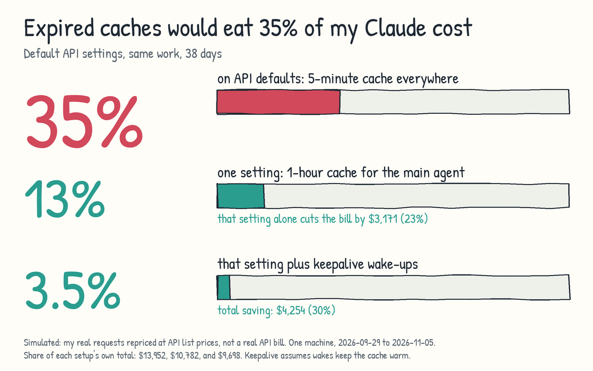

# warmcache

Find out what expired prompt caches cost you in Claude Code, and keep them warm with two small hooks.

> **EXPERIMENTAL. READ THIS BEFORE INSTALLING.** This plugin depends on cache lifetimes, prices, and hook behavior that Anthropic controls and can change at any time, without notice. Used wrongly, it can cost you more, not less.
>
> This has happened before. Users measured Claude Code cache writes moving from 1 hour to 5 minutes around early March 2026, with no announcement they could find ([issue 46829](https://github.com/anthropics/claude-code/issues/46829), closed as not planned). In that issue, [Jarred-Sumner, writing for the Claude Code team](https://github.com/anthropics/claude-code/issues/46829#issuecomment-4231266649), describes the change as deliberate optimization, not a regression. A later report ([issue 84253](https://github.com/anthropics/claude-code/issues/84253), still open) saw 5-minute-only writes from 2.1.218. Later comments in that thread say the remainder was a detection gap: a subscription token passed through `ANTHROPIC_AUTH_TOKEN` gets the API-key default, and one commenter measured 1 hour on all 29 versions tested with a plain subscription login. The commenter [bcherny](https://github.com/anthropics/claude-code/issues/46829#issuecomment-4237689126), whose GitHub profile says "Claude Code @ Anthropic", wrote: "we use experiment gates that are cached client-side" and "We also are not defaulting API customers to 1h yet".
>
> Run the report before and after any Claude Code upgrade.

## What it costs




On default API settings, cache expiries would be about a third of the cost on this machine (simulated): 33.0% of total spend, range 32.1% to 35.0% depending on the expiry assumption. The actual share on this machine was 13.4%, because it ran the main agent on 1 hour.

| Scenario | Main | Subagents | Total |
| --- | --- | --- | --- |
| Everything on 5 minutes | $7,127.03 | $6,417.45 (measured) | $13,544.48 |
| Main 1 hour, subagents 5 minutes (actual use here) | $4,377.05 (measured) | $6,417.45 (measured) | $10,794.50 |
| Everything on 1 hour | $4,377.05 (measured) | $6,558.98 | $10,936.03 |

Cache expiries cost $4,468.12 on 5 minutes (33.0%, simulated) and $1,448.41 on the actual setup (13.4%). Simulated keepalive on the actual setup: cost $138.80, expiry avoided $1,223.56, net $1,084.76 ($1,009.19 if sessions are abandoned). Of the $1,084.76 net, the main agent is $300.03 and subagent check-ins are $784.73. The subagent figure assumes check-ins that only a foreground Bash timeout above 270 seconds triggers, and $120.76 of the $878.67 subagent expiry avoided has no such timeout, so the hook cannot act on it. The report prints the 5-minute expiry cost as the row "Extra cost of expiries" under "Everything on 5 minutes".

Simulated from one heavy multi-agent machine: 157,267 requests from 2026-09-29 to 2026-11-05, API list prices, not a real bill. Unmarked values are simulated. The same requests and pauses are assumed in every row. Run the report for your own numbers, because yours will differ. The arithmetic is in [docs/pricing-math.md](docs/pricing-math.md).

## The other side

Jarred-Sumner, writing for the Claude Code team, [replied](https://github.com/anthropics/claude-code/issues/46829#issuecomment-4231266649) with these points:

- 1-hour writes cost more (2x vs. 1.25x) and do not pay off for one-shot requests.
- The client selects a lifetime per request.
- The change lowers cost across the request mix.

This report charges every write at the lifetime's price, so one-shot requests are counted.

On this data, 76.8% of main agents and 86.4% of subagents never hit a pause of 5 to 60 minutes. For those, 5 minutes is the right choice, which agrees with Anthropic's argument. Agents with 4 or more pauses are where 1 hour wins: main agents $6,413.58 on 5 minutes vs. $3,593.25 on 1 hour, subagents $1,238.51 vs. $703.36. Over all subagents the two lifetimes are close: $6,417.45 measured on 5 minutes vs. $6,558.98 simulated on 1 hour. The main agent saves far more on 1 hour: $7,127.03 (simulated) vs. $4,377.05 (measured).

Their claim covers all users, which this data cannot test. bcherny also wrote that the savings are "nowhere near 12x" and "a small win".

## Before you install

- Claude Code 2.1.318 changelog: "Changed background subagents to move a shell command to the background after 3 minutes on all providers, so the prompt cache doesn't expire while it runs".
- Claude Code 2.1.314 changelog: "Added idle compaction to VS Code and Claude Desktop's Code tab: a 200K+ token conversation left idle is summarized, and the summary is used on your next message if the prompt cache has expired".

Newer versions may already cover part of this.

API users should first set `"promptCacheTtl": "1h"` in settings. It needs v2.1.242 or later and no plugin.

Subscription users: wakes use plan quota, how quota weights cached reads is unknown, and the savings are not proven for subscriptions.

## How it works

- **Subagent hook.** A PreToolUse hook denies foreground Bash timeouts above 270 seconds in subagents. It does nothing when `CLAUDE_CODE_DISABLE_BACKGROUND_TASKS` is set to a truthy value, because the instruction cannot be followed, or when `CLAUDE_CODE_SUBAGENT_PROMPT_CACHE_TTL` is `1h`, because the reason would be false. A `subagentPromptCacheTtl` setting of `1h` is not detected, so set `WARMCACHE_SUBAGENT=0` then. It does not shorten them, because a test showed a shortened timeout killed the command with exit code 143. The denial tells the subagent to rerun in the background.
- **Stop hook.** A Stop hook with `asyncRewake` sleeps 59 minutes, then wakes the session for a one-word turn. It wakes at most 4 times before the limit resets, and only when the last cache write was 1 hour. The limit resets on every `UserPromptSubmit` event. The Claude Code docs say that event also fires on some turns Claude Code starts on its own, so the limit can reset on those too. This is untested. The sleep ends at the newest cache write plus the interval, a newer Stop or prompt ends it within about 5 seconds, and a wake that would come more than 60 seconds late (for example after a laptop suspend) is skipped because the cache has probably expired already. Each wake is a real turn in the transcript. The rule the math supports: main agent on 1 hour with an optional wake at 59 minutes, subagents on 5 minutes with a check-in every 4:30 while waiting. See [docs/pricing-math.md](docs/pricing-math.md).

## Test status

Unit tests pass (`npm test`). Run against Claude Code:

- `asyncRewake` woke a headless stream-json session on Claude Code 2.1.310 with a 12-second interval, and the wake limit held (2 wakes with a limit of 2, then none).
- Subagent hook, 2.1.310, haiku, cap set to 5 seconds: a subagent asked to run `sleep 12; echo finished` with a long Bash timeout was denied, then reran the same command with `run_in_background: true` and read the output `finished`. One run.
- A review confirmed that `claude plugin validate` passes, that `--plugin-dir` loads the plugin on 2.1.310, and that a wake fired and a limit of 1 held in a live headless run.
- In one-shot `-p` mode the transcript at Stop lacked the current turn, so no sleeper started.

Untested: an interactive session, the real 59-minute interval, laptop suspend, `/clear` with a pending sleeper, and whether interactive sessions see a stale cache lifetime at Stop.

## Install

Requirements: Node 22 or newer on PATH.

```text
/plugin marketplace add versa-training/warmcache
/plugin install warmcache@warmcache
```

Restart Claude Code.

## Commands

- `/warmcache:report` prints the cost report.
- `node scripts/cache-report.js --days N --dir PATH --json` runs it from a clone.

## Configuration

| Variable | Default | Effect |
| --- | --- | --- |
| `WARMCACHE_MAIN=0` | on | Turns off the Stop hook wakes. |
| `WARMCACHE_SUBAGENT=0` | on | Turns off the subagent hook. |
| `WARMCACHE_SUBAGENT_WAIT_MS` | 270000 | Longest foreground Bash timeout a subagent may use. |
| `WARMCACHE_MAIN_INTERVAL_SEC` | 3540 | Seconds between wakes. Setting it skips the 1-hour check, and a headless run may then wait for a pending sleeper before it exits. |
| `WARMCACHE_MAX_WAKES` | 4 | Wakes allowed before the limit resets (see How it works). |
| `WARMCACHE_STATE_DIR` | `~/.claude/warmcache` | Where wake state is stored. It must be a real directory you own, not a symlink, or the hooks do nothing. |

## Privacy

Everything stays local. The plugin code makes no network calls. Wakes and the report's chat output go to the model like any other turn.

## Similar projects

- [claude-code-cache-keepalive](https://github.com/yujiachen-y/claude-code-cache-keepalive) uses a blocking Stop hook. Its README warns it makes things worse on subscriptions.
- [claude-code-cache-warmer](https://github.com/AshitaOrbis/claude-code-cache-warmer) uses a local proxy and a replay timer.

## Development

```bash
npm test
```

See [CONTRIBUTING.md](CONTRIBUTING.md) and [CHANGELOG.md](CHANGELOG.md).

## About

warmcache is from the team behind [versa.training](https://versa.training). Looking for a tool to help your team master difficult conversations? Check out [versa.training](https://versa.training).

## License

[MIT](LICENSE)
